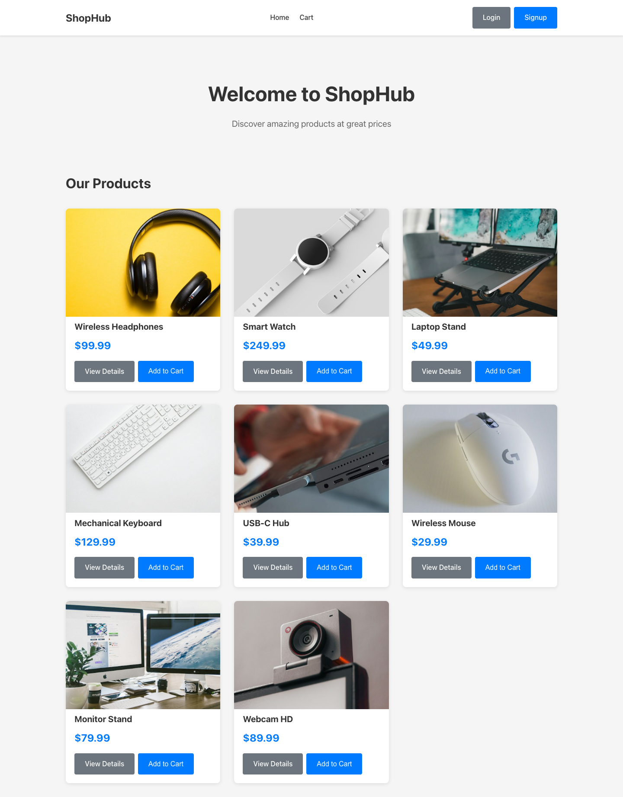
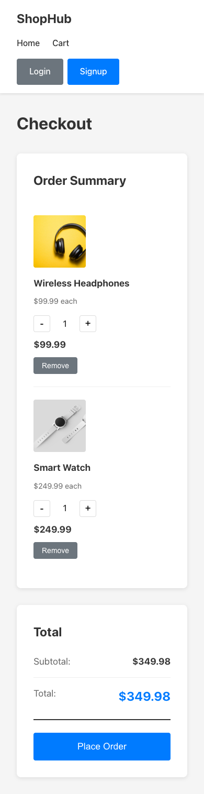

# ShopHub | React E-commerce Demo

[](https://github.com/JustineVizco25/mini-ecommerce-website/actions/workflows/ci.yml)

A frontend learning project that connects product browsing, demo accounts, a persistent shopping cart, and simulated checkout. Built with React, React Router, React Hook Form, and plain CSS.

The project demonstrates how reusable components, shared state, routing, form validation, and browser storage work together across a complete shopping flow.

**Reviewing this for a frontend internship?** Start with the [three-minute walkthrough](#three-minute-walkthrough), then follow the [code tour](#code-tour) to the implementation.

> This is a frontend demo. Accounts and passwords are saved in plain text in browser localStorage; use made-up credentials. Orders are simulated, and no payment is collected.

## Preview



<details>
<summary>View the mobile checkout</summary>



</details>

## Run locally

Use **Node.js 24 LTS** and npm. No API keys, environment variables, or backend setup are required. Product photos load from Unsplash and need an internet connection.

```bash
git clone https://github.com/JustineVizco25/mini-ecommerce-website.git
cd mini-ecommerce-website
npm ci
npm run dev
```

Open the local URL printed by Vite, usually `http://localhost:5173`.

## Three-minute walkthrough

1. **Browse products.** The home page displays eight products. Open **View Details** on Wireless Headphones to see the description and price.
2. **Build a cart.** Add the headphones twice, then add a Smart Watch. The cart should contain two headphone units and one watch, totaling **$449.97**.
3. **Edit the order.** Open **Cart**, increase or decrease quantities, and remove an item. Decreasing a quantity to zero removes that item. Refresh the page to confirm the cart survives a reload.
4. **Try guest checkout.** Select **Place Order** while signed out. The app asks you to log in and provides a link to the account form.
5. **Create a demo account.** Follow that link, switch to **Sign Up**, and use a made-up email such as `recruiter@example.com` with a sample password such as `demo123`. Passwords must be 6–12 characters. The app returns to checkout with the cart intact.
6. **Complete the simulation.** Select **Place Order** again. The confirmation appears and the cart clears. No purchase, payment, or order record is created.
7. **Check the smaller details.** Try an incorrect password, a duplicate email, a mobile viewport, `/products/999`, or an unknown route. Log out and log in again to check the account flow.

Accounts and the cart belong to the current browser origin. The cart is shared within that browser rather than tied to an account. Clearing this site's browser storage resets the demo; using a private browser window starts a separate session.

## Features and skills demonstrated

| Area | What to look for |
| --- | --- |
| React components | Product cards and navigation reused across route views. |
| Shared state | Separate authentication and cart Context providers, exposed through custom hooks. |
| Client-side routing | Product IDs in dynamic routes; authentication remembers a checkout return path. |
| Forms | React Hook Form handles required fields and password length; account failures appear as alerts. |
| Cart behavior | Repeated additions update quantities, item controls update totals, and checkout clears the cart. |
| Persistence | Accounts, the demo session, and cart data use localStorage; malformed data falls back safely. |
| Responsive CSS | CSS Grid, Flexbox, and a mobile breakpoint adapt the catalogue, details, and checkout. |
| Accessibility basics | Labelled inputs, native buttons for form switching, named quantity controls, and visible keyboard focus. |
| Verification | Playwright browser tests exercise shopping flows and edge cases against a production build; GitHub Actions runs lint and tests. |

## Code tour

These files are a useful starting point for a technical review:

1. **[App.jsx](src/App.jsx)** assembles the providers, shared navigation, and route views. **[main.jsx](src/main.jsx)** mounts the app inside BrowserRouter and React StrictMode.
2. **[products.js](src/data/products.js)** defines the eight-product catalogue and lookup functions. **[ProductCard.jsx](src/components/ProductCard.jsx)** and **[ProductDetails.jsx](src/pages/ProductDetails.jsx)** read the same data and cart state.
3. **[CartContext.jsx](src/context/CartContext.jsx)** owns item IDs and quantities, joins them with product data, calculates totals, and persists changes. Functional state updates preserve the current cart when adding or changing quantities.
4. **[AuthContext.jsx](src/context/AuthContext.jsx)** implements browser-local signup, login, and logout. It normalizes emails for comparison and restores a session only when the saved account exists. **[Auth.jsx](src/pages/Auth.jsx)** handles validation, mode switching, and the return destination.
5. **[storage.js](src/utils/storage.js)** contains guarded storage helpers. Invalid JSON falls back safely; unavailable storage leaves browsing and the in-memory cart usable, while account forms explain the storage requirement.
6. **[Checkout.jsx](src/pages/Checkout.jsx)** connects quantity controls, item removal, totals, checkout validation, and the confirmation state.
7. **[storefront.spec.js](tests/storefront.spec.js)** provides executable examples of the expected behavior.

### Project structure

```text
src/
├── components/          # Shared navigation and product cards
├── context/             # Auth/cart providers, Context values, and custom hooks
├── data/products.js     # Static catalogue and product lookup
├── pages/               # Home, auth, product details, checkout, and not-found views
├── utils/storage.js     # Safe browser-storage access
├── App.jsx              # Providers and routes
├── App.css              # Application styles and responsive layouts
└── main.jsx             # React entry point
tests/                   # Browser regression tests
docs/images/             # Screenshots of the actual application
.github/workflows/ci.yml # Automated lint, build, and browser checks
```

### Routes

| Route | View |
| --- | --- |
| `/` | Product catalogue |
| `/products/:id` | Product details; unavailable products redirect home |
| `/auth` | Signup by default; navigation state selects login and an optional return path |
| `/checkout` | Cart, totals, and simulated ordering |
| Any other path | Not-found page with a link back to the catalogue |

### Implementation choices

- **Context API:** authentication and the cart need to be shared across several pages. Two small providers keep those concerns separate without introducing an additional state library.
- **Static catalogue:** the project can be reviewed immediately without a running API. Cart entries store only product IDs and quantities; names, images, and prices come from the catalogue.
- **Browser-local persistence:** localStorage makes refresh behavior easy to explore. Stored cart entries are checked before use, and reads and writes handle unavailable storage.
- **Plain CSS:** the layouts use CSS Grid and Flexbox directly, with reusable button, form, and card classes.
- **Separate Context modules:** custom hooks and Context values live outside the provider component files to keep component exports compatible with Vite Fast Refresh.

## Verification

Install the test browser once, then run lint and the test suite:

```bash
npx playwright install chromium
npm run lint
npm test
```

On Linux, `npx playwright install --with-deps chromium` also installs the system packages needed by the browser. Alternatively, if Google Chrome is already installed, macOS/Linux users can run `PLAYWRIGHT_CHANNEL=chrome npm test`.

`npm test` builds the application, starts a local production preview on port **4178**, and runs **14 browser tests**. Each test uses isolated browser storage and checks for uncaught JavaScript errors. The suite covers:

- Catalogue-to-detail navigation and both authentication entry points.
- Keyboard form switching and stale validation errors.
- Signup, duplicate accounts, case-insensitive email matching, invalid credentials, session restoration, and logout.
- Cart arithmetic, multiple products, quantity changes, removal, and persistence after refresh.
- Guest checkout, signup with a return to checkout, successful ordering, and empty-cart validation.
- Malformed saved accounts, invalid saved cart entries, and blocked browser storage.
- Invalid product IDs, unknown routes, and horizontal overflow at a 320-pixel viewport with a long account email.

The [GitHub Actions workflow](.github/workflows/ci.yml) runs lint and the same production-build browser suite on pushes to `main` and on pull requests. Tests currently target Chromium; cross-browser coverage and a full accessibility audit remain future work.

Other commands:

| Command | Purpose |
| --- | --- |
| `npm run dev` | Start the development server with hot updates |
| `npm run build` | Build the production bundle into `dist/` |
| `npm run preview` | Serve an existing production build locally |
| `npm audit` | Check the installed dependency tree for reported vulnerabilities |

## Bug fixes included

- **Wrong account form after navigation:** choosing Login or Signup while already on `/auth` now updates the form because its mode follows router state.
- **Crashes from saved account data:** invalid JSON and unexpected account records are handled before authentication reads them. Storage failures produce a form error instead of an uncaught exception.
- **Lost carts after refresh:** cart state now restores from validated browser storage and saves changes, including removal and checkout clearing.
- **Inconsistent quantity updates:** cart updates use the latest state and normalize product IDs; invalid quantities are rejected.
- **Blank unknown routes:** a not-found page provides a way back to the catalogue.
- **Keyboard and layout issues:** form switches use buttons, quantity controls have accessible names, navigation uses its intended CSS class, and long account emails can wrap.
- **Vulnerable development dependencies:** compatible dependency updates were applied and the lockfile was refreshed.

## Scope and next steps

This project practices frontend behavior. Its demo authentication can be modified through browser tools and does not provide an authorization boundary. Passwords are stored in plain text, and accounts should contain no real credentials. A production version would need server-side authentication, password hashing, secure session management, and server-validated prices and orders.

There is currently no backend, payment integration, order history, inventory enforcement, search, or filtering. Product images are remote Unsplash assets. Checkout totals use the static catalogue prices in USD; tax and shipping are not calculated.

Useful next steps are a product API with loading and error states, production authentication, account-specific carts, search and filtering, and Firefox/WebKit plus accessibility testing.

For static hosting, publish the contents of `dist/` and configure a fallback to `index.html` so direct visits to client-side routes work. Hosting under a subpath also requires matching Vite base and router basename settings. This repository does not configure a hosted deployment.

## Credits

Scaffolded with Vite's React template. Product photographs are served from Unsplash; source image URLs are listed in [products.js](src/data/products.js).
